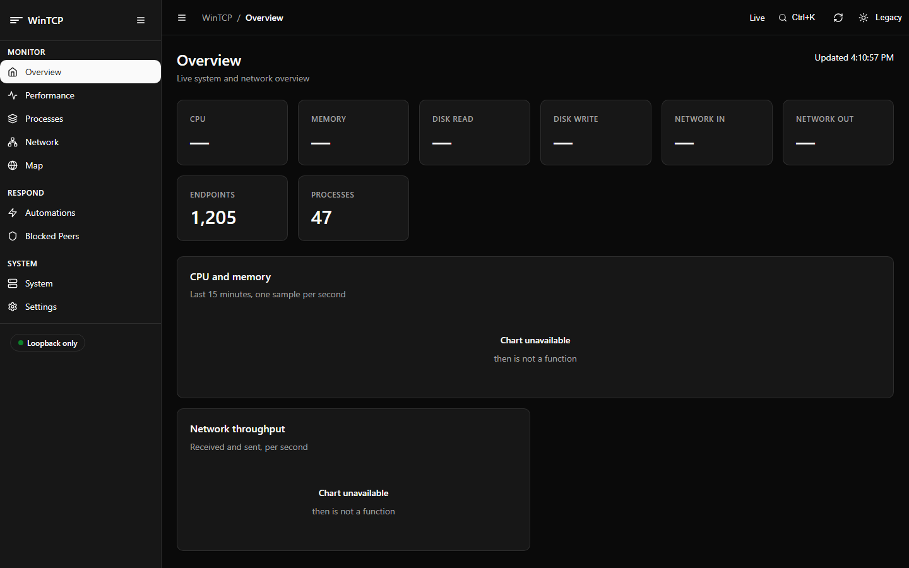
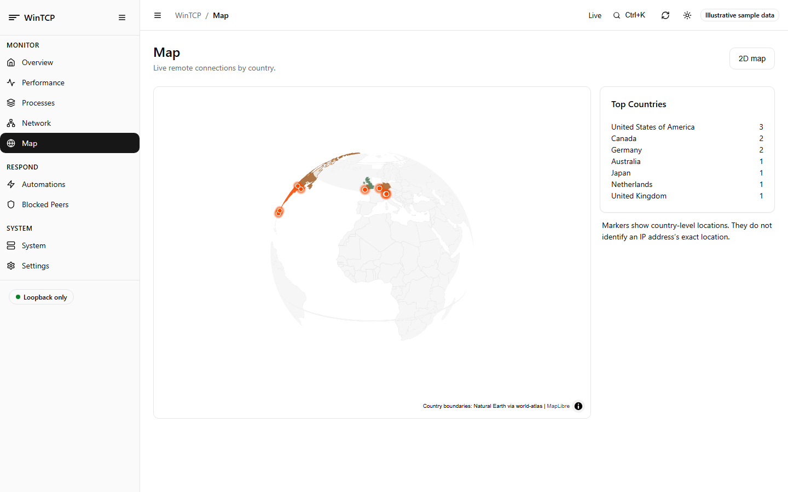
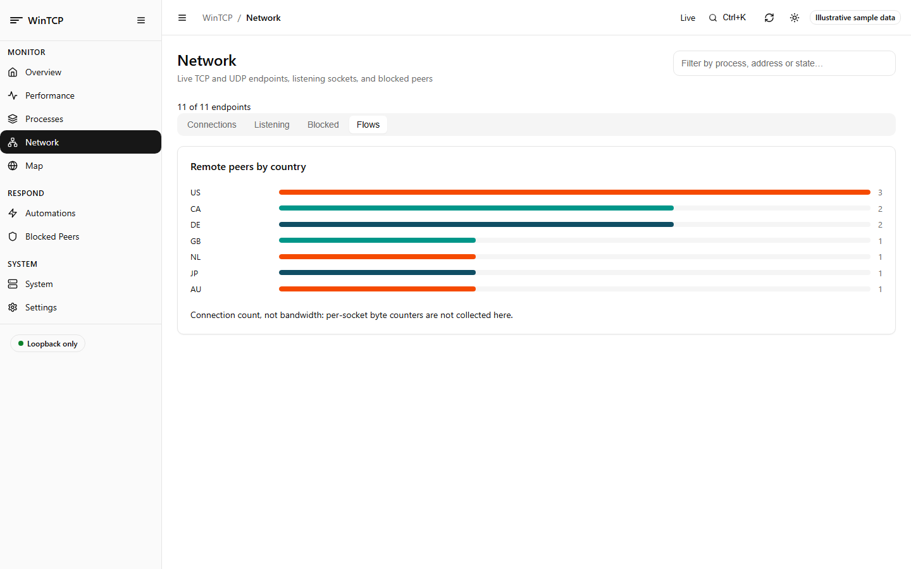
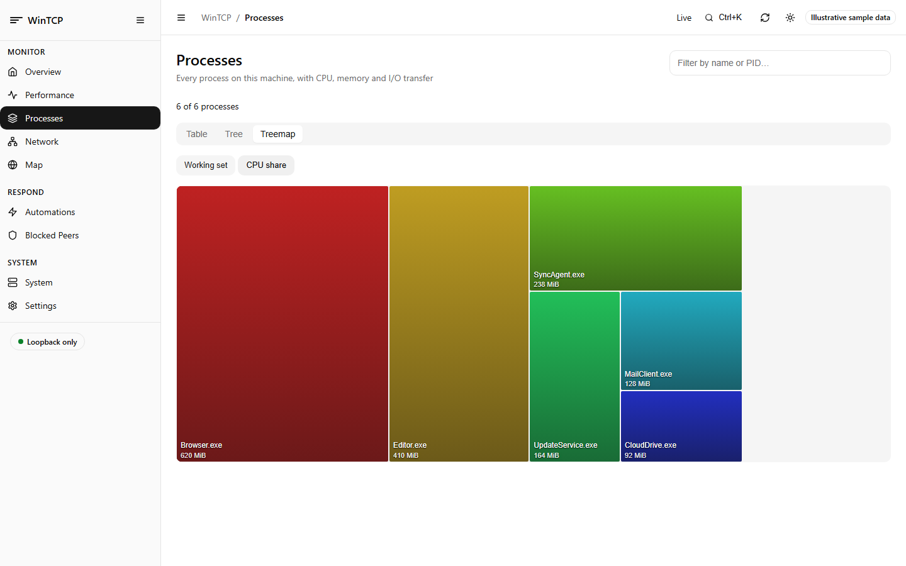
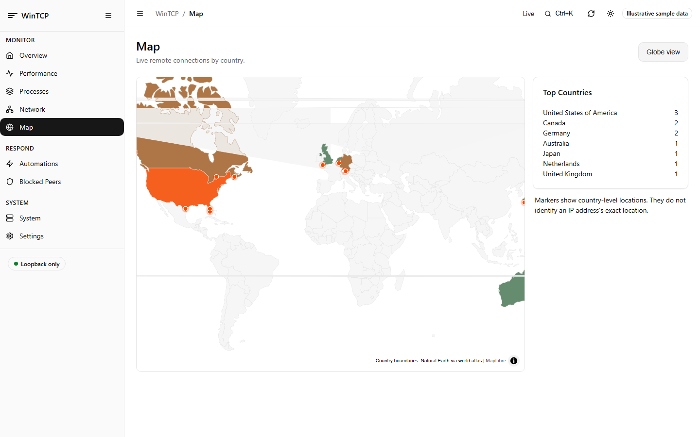
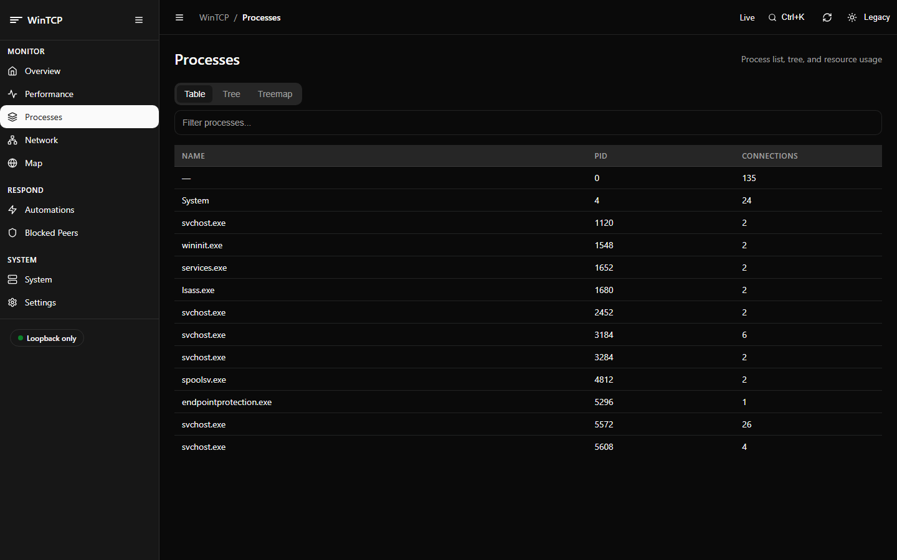

# WinTCP

**See live TCP and UDP endpoints, their owning processes, and the traffic between them.** WinTCP is a native Windows x64 application with a command-line interface, a standalone desktop window, and an optional local Web UI.

[](https://github.com/Sean-Khorasani/WinSys/releases)
[](https://en.cppreference.com/w/cpp/17.html)
[](https://learn.microsoft.com/windows/win32/)
[](LICENSE)

WinTCP reads Windows networking tables directly and associates endpoints with process details. It also provides searchable tables, traffic and TCP health metrics, GeoIP enrichment, connection monitoring, and guarded actions such as closing a connection or blocking a peer.

## Download

Download the [Windows x64 release](https://github.com/Sean-Khorasani/WinSys/releases/latest). Extract the ZIP and keep `wintcp.exe`, `wintcp-gui.exe`, the `webui` folder, and the service helper files together.

- Run `wintcp-gui.exe` to open the native desktop app.
- Run `wintcp.exe` in a terminal to use the CLI; `wintcp.exe help` lists commands.
- Start the optional browser dashboard with `webui-service.bat start`. The command prints its loopback URL. Use `webui-service.bat status` and `webui-service.bat stop` to manage it.

The CLI and GUI are separate applications; neither launches or depends on the other. The Web UI additionally needs the adjacent `webui` asset folder.

## Screenshots

The gallery uses example data so it does not publish live process names, addresses, or other machine-specific details.

| Overview | World map |
|---|---|
|  |  |

| Network flows | Process treemap |
|---|---|
|  |  |

| 2D map projection | Process table |
|---|---|
|  |  |

The map can switch between a globe and a 2D projection. It groups remote connections by country when a GeoIP database is configured; markers show country-level estimates, not precise locations. See the [Map guide](docs/webui.md#map-and-network-flows).

## What WinTCP provides

- **Connections:** IPv4 and IPv6 TCP/UDP endpoints with process, service, path, protocol, address, port, and state details.
- **Traffic and health:** Per-process byte totals, connection age, per-socket rate, and TCP metrics such as RTT and retransmits where Windows exposes them. ETW can add UDP totals when run elevated.
- **Process context:** CPU, memory, I/O, parent process, integrity, and signature information, with table, tree, and treemap views in the Web UI.
- **Enrichment:** Optional reverse DNS uses the Windows resolver; country and autonomous system results come from a local GeoIP database.
- **Monitoring and response:** CLI connection monitors and change feeds, saved views, on-demand Web UI CLI playbooks, firewall-rule review, and explicit confirmation for sensitive actions. Web UI playbooks are not active monitors.
- **Portable runtime:** No installer, third-party runtime, or network service is required. The Web UI binds to loopback and uses local assets.

## Quick examples

```bat
:: Show listening endpoints, with the process and local port
wintcp.exe list --filter "state:listen" --sort lport --columns pid,process,local,lport,state

:: Rank processes by observed network traffic
wintcp.exe list --group --traffic --sort nettotal --desc --limit 10

:: Watch for new TCP connections
wintcp.exe list --watch 1 --changes --event appear --count 30 --filter "proto:tcp state:estab"

:: Preview an action without changing system state
wintcp.exe kill --select "ipv4: local:port:49665" --dry-run
```

The CLI is designed for scripts: each command documents its output and exit codes, and unsupported switches are rejected rather than ignored. Destructive actions require `--yes`; use `--dry-run` to preview a plan first. See the [CLI reference](docs/cli.md) and [cookbook](docs/cookbook.md) for complete syntax and examples.

## Requirements and permissions

WinTCP supports Windows 10 and 11 on x64. It has no runtime dependencies. The core connection list works without elevation. Some features require administrator rights:

| Feature | Permission or requirement |
|---|---|
| Per-socket TCP counters and health metrics | Windows 10 version 1703 or later; available without elevation when supported by the socket. |
| ETW traffic counters, including UDP | Administrator rights. Without ETW, WinTCP uses the available TCP per-socket counters. |
| Close a connection | Administrator rights; Windows supports this operation for IPv4 only. |
| Add or remove firewall rules | Administrator rights and explicit confirmation. |
| Packet capture | Administrator rights and the Windows packet-capture components. |

WinTCP does not elevate itself or prompt for elevation. A privileged operation reports why it cannot proceed when permissions are insufficient.

## GeoIP database

No GeoIP database is included. To use country enrichment, supply a MaxMind-format `.mmdb` database obtained under its licence. WinTCP never downloads a database or sends connection details to a hosted GeoIP lookup service. Reverse DNS, when requested, uses the Windows DNS resolver and may contact configured DNS servers.

- **CLI:** pass `--db FILE` to a supported command, or `--asn-db FILE` for a separate ASN database.
- **GUI:** choose the country or ASN database from the **View** menu.
- **Web UI:** set the database path in **Settings**.

Country-level results require routable addresses covered by the database. Private, loopback, link-local, documentation, and other reserved address ranges are not assigned a country. See [GeoIP in the GUI guide](docs/gui.md#geoip-in-the-window) and the [Web UI guide](docs/webui.md#map-and-network-flows).

## Documentation

| Guide | Topics |
|---|---|
| [GUI guide](docs/gui.md) | Desktop layout, columns, filters, details, charts, settings, and keyboard shortcuts. |
| [Web UI guide](docs/webui.md) | Dashboard pages, map, flows, processes, automations, security, and local service controls. |
| [CLI reference](docs/cli.md) | Commands, switches, exit codes, output formats, and columns. |
| [Filter language](docs/filters.md) | Filter syntax, fields, units, quoting, and examples. |
| [Cookbook](docs/cookbook.md) | Worked recipes for monitoring, investigation, export, and response. |
| [Traffic counters](docs/traffic.md) | ETW and per-socket collection, supported metrics, and limitations. |
| [Architecture](docs/architecture.md) | Data flow, concurrency, and source organization. |
| [Web UI design guide](docs/webui-design.md) | Design tokens and conventions for extending the interface. |

## Build from source

Build on Windows with Visual Studio 2022 or later and the **Desktop development with C++** workload (MSVC and Windows SDK). No package manager or third-party libraries are required.

```bat
build.bat
build.bat -Test
```

`build.bat` produces the CLI and GUI executables. `build.bat -Test` also runs the headless CLI smoke checks and unit tests. CMake is supported as well:

```bat
cmake -S . -B build-cmake -G "Visual Studio 17 2022" -A x64
cmake --build build-cmake --config Release
```

## Troubleshooting

- **Country information is blank:** configure a supported `.mmdb` database. Reserved addresses have no country result.
- **UDP traffic is unavailable:** run elevated to enable ETW collection. The unprivileged fallback measures supported TCP sockets only.
- **A traffic value is shown as `—`:** Windows could not provide a reading for that socket; unavailable is not the same as zero.
- **The Web UI does not load:** keep `webui` beside `wintcp.exe`, start the service helper, and open the loopback URL it prints.
- **A command rejects a switch:** run `wintcp.exe help <command>` to see the switches that command supports.

## License

WinTCP is released under the [Apache License 2.0](LICENSE). Third-party Web UI assets and their licences are listed in [THIRD_PARTY_NOTICES.md](THIRD_PARTY_NOTICES.md) and `wintcp/webui/vendor/LICENSES/`.
